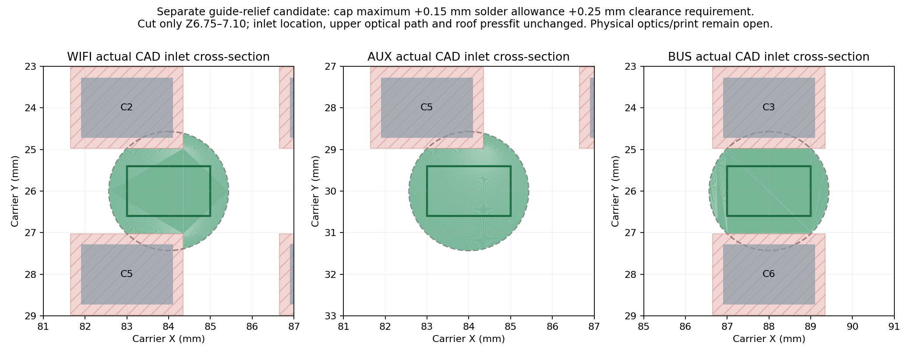

# Parametric Rev3C enclosure review

This is an editable analytical derivative of the [recovered prototype](../prototype/). It keeps a common base, module-specific C3/C6 lids and three light guides. The selected carrier outline and both appliance power inputs are preserved. The four lids support internal/external antenna concepts; exact cable, switch and printed-assembly qualification remains open.

**Use review exports for dimensional review and coupons. They are not approved production files.** Fixed original button reaches fail nominal actuation at an installed stack of 11.0 mm. The common closure permits a wrong lid: a C3 BOOT foot sits over the C6 U.FL. No simple mechanical key could be found (see [Module identification](#module-identification-2026-11-24)), so each lid carries a large C3/C6 label on the roof and inside. Check it before assembly; labels do not mechanically prevent this mistake.

The [source-bound report](review/CASE-ANALYSIS.md) records valid solids, installed-stack samples, component envelopes, actual guide routes, plug gauges and antenna provisions. Analytical geometry was generated with build123d 0.10.0 / cadquery-ocp 7.8.1.1.post1. The original analysis used a different toolchain from the recovered historical requirements; the subsequent pinned reproduction is recorded below. These versioned checks are not physical fit, material or RF tests.

The [subsequent pinned reproduction](review/pinned-reproduction/GE-Pinned-CAD-Reproduction-2026-10-05.md) closes that setup/reproduction limitation for the frozen 77f4c88 source. build123d 0.11.1/trimesh 5.1.0 produces 51 independently checked STEP/STL pairs, and the 20 nominal shape comparisons and 12 stack samples agree with the prior engine. The original two top-level requirements do not establish the old transitive dependency closure; all 47 packages used in the new run are recorded. Future parameter/source changes require their own checks. Printed fit and physical qualification remain open.

## Coordinate frame fix (2026-11-23)

**Exports made before this change are mirror images of the real part and must not be printed.** All dimensions in `enclosure.py`, `interface_baseline.py` and `current_carrier_bounds.json` are KiCad board coordinates: x right, y *down* in the top view. The geometry was built in that frame with z up, which is left-handed. The printed case therefore had the J1 (RJ45), USB-C and light-guide features on the wrong long side of the board.

Three checks confirmed this:

- **Handedness.** KiCad's own 3D export maps board +y to −y in a z-up frame, and the Rev2 Fusion case also uses y = −KiCad y.
- **Placement sampling.** With the corrected exports, sample points inside the J1 body and both XIAO socket rows of the real Rev3D board are clear of printed solid. The old convention collides at J1 and J5.
- **End-wall opening.** The J1 opening used to span physical y 7.8–25.9 mm against an RJ45 body at y 14.8–31.2 mm, so the plug would hit the wall. It now spans 14.1–32.2 mm.

Geometry is still built and checked in the KiCad frame, so every existing clearance screen keeps its meaning. `enclosure.export()` and `interface_baseline._export()` now mirror each part once about the board centreline (y = 20 mm) into the physical frame. `legend()` pre-mirrors each label glyph about its own centre so the embossed text still reads correctly. The check: a readable text solid at each label's physical position overlaps the carved lid by 0 mm³, and a mirrored one does not. Volumes are unchanged. Earlier slicer times and filament figures still apply, but re-slice before printing.

## Magnet mount option (2026-11-23)

`--magnets 6x2|8x2|10x2` adds four corner pockets to the base for N52 disc magnets (diameter × thickness in mm), so the case can sit on a steel appliance panel. `--magnet-style` picks how the magnets are held:

| Style | How | Hold | Skin to cavity floor |
|---|---|---|---|
| `glue` (default) | Open pocket on the bottom; glue the disc flush (CA or epoxy) | Strongest: the magnet touches the steel | 1.3 mm |
| `press` | Open pocket with three 0.6 mm crush ribs standing 0.25 mm into it; press the disc in, no glue | Same as glue | 1.3 mm |
| `embedded` | Sealed pocket 0.55 mm above the bottom face. Pause the print before the reported layer (2.95 mm for a 0.35 mm first layer and 0.2 mm layers), drop the discs in with the same pole up, and resume | About a third less, because of the 0.55 mm skin; invisible and cannot fall out | 0.65 mm |

Pockets are at x 9/70 mm, y 1.5/38.5 mm (KiCad frame). Every size and style keeps a single valid solid with full skins. Pressed discs meet only the ribs (about 0.18 mm³ of interference), and the embedded pockets are fully enclosed. The export receipt records the pocket coordinates and the pause height. Gluing magnets inside the case is not offered: the floor would leave about 1.2 mm of plastic between magnet and steel, and the magnets would sit under the electronics. For no reprint at all, put adhesive magnet tape on a plain base. Without `--magnets` the base is unchanged, and `base(magnets=True)` keeps the original two-pocket layout.

Expect much less holding force on thin, painted or curved panels than the catalogue pull rating. Sliding on a vertical panel is the weak direction. A metal panel behind the module also shortens Wi-Fi range; the external-antenna lid helps if range suffers. Keep away from hot spots: PLA softens around 55–60 °C, so use PETG or ASA there.

## Antenna options (2026-11-23)

`--antenna` picks the lid roof. The options apply to both modules:

| Option | What the lid has | Use it for |
|---|---|---|
| `fpc` | Keeper rails, an entry stop and two cable keepers under the roof for a 40 × 20 mm flat FPC antenna on the module U.FL | The FPC antenna that ships with the XIAO C3 (the C3 has no onboard antenna), or a C6 set to its U.FL port |
| `smooth` | Plain roof, no antenna features | The C6 onboard ceramic antenna, or your own antenna mounting |
| `external` | 12 mm bulkhead bore through the long side wall at x 56 mm, z 15.5 mm, plus a printed cable keeper | An SMA/RP-SMA pigtail from the module U.FL |
| `internal` | The original pairing: C3 → `fpc`, C6 → `smooth` | Reproducing earlier exports |

The `fpc` export also writes `proxy_fpc_antenna_40x20`, a reference body for checking clearance. It is not a printed part. Checks: in every option, all 67 Rev3D 3D models clear printed solid. The FPC body sits at z 26.4–28.2 mm, clear of the lid and every part (module top ≤ 22.4 mm). The keeper fit, cable bend room, bulkhead hardware and RF performance are unverified. The C6 module's own U.FL position is taken from the C3 layout and is not modelled separately.

## Module identification (2026-11-24)

**There is no mechanical key. A C3 lid still closes on a C6 module and the reverse. Each lid is labelled instead, and you must check the label.**

### What differs between the modules (as modelled)

The base, carrier and module outline are shared (both modules: 77.46-98.44 x 4.02-21.82 mm in carrier coordinates), so a key has to sense the module, not the base. Heights are above the module PCB top; the Rev3D stack puts that at z 18.175 mm.

| Feature | C3 | C6 | Height | Source quality |
|---|---|---|---|---|
| BOOT / RESET switch | x 79.0, y 8.47 / 17.36 | x 97.35, y 19.49 / 6.34 | 1.5 / 0.53 mm | conditional, parts unconfirmed |
| U.FL | x 78.87, y 12.92 | x 78.88, y 8.62 | 1.45 mm | screen |
| Ceramic antenna | none | x 77.5-79.7, y 13.3-18.7 | 1.2 mm | assumed screen |
| SoC package | x 84.8-89.8, y 12.8-17.8 | x 83.8-88.8, y 13.4-18.4 | 0.84 mm | official KiCad |
| Small passives | none modelled | four at x 82-87, y 7.4-18.4 | 0.5-0.8 mm | official KiCad |
| USB-C shell | x 92.4-99.8 | x 92.5-99.8 | same | official KiCad |

The vendor STEP models are bare-PCB-derived. They do not contain the RF shield, switches, U.FL, ceramic antenna or header, and the shield's position and height are not in the repository.

### Why a key was not added

A key must land on something sturdy that is on one module only, at least 1 mm of lid travel before any lid tab reaches a fragile part. Every modelled feature that is 1 mm or taller and differs between the modules is one the key must not use: the U.FL, the ceramic antenna and the switches. What is left is 0.84 mm tall at most (the SoC package, offset only 0.5-0.9 mm between modules) or small passives. A post that sits 0.3 mm above bare PCB on the right module would touch the SoC on the wrong one when the lid is only about 0.5 mm from seated, which is too late and lands on a chip. The RF shield could be a good stop, but its position, height and strength are unmeasured, so none was invented. If you measure real modules and find a shield or other body on one that is absent on the other, a post on that lid is easy to add.

Wrong-lid geometry at the review parameters (stack 11.325 mm), foot bottom to the highest module body under the foot:

| Lid on module | Contact | Vertical gap |
|---|---|---|
| C3 on C6 | BOOT foot over U.FL (1.45 mm) | 0.30 mm; the foot's 0.40 mm button travel crosses it |
| C3 on C6 | RESET foot over ceramic antenna (1.2 mm, assumed) | 0.55 mm |
| C6 on C3 | both feet over bare module PCB | 0.78 mm; lid rests on its feet, 0.78 mm proud |

The reverse (C6 lid on C3) is harmless to the module: the lid stops short, the feet sit on bare PCB. The C3 lid on a C6 is the harmful direction, and only when a button is pressed or a U.FL plug is fitted.

### How to tell lids apart

- **Roof:** a large debossed `C3` or `C6` (3.6 mm type, about 2.6 mm tall letters) next to the USB end. It shows in the label inlay export, so a second-colour print makes it stand out.
- **Inside:** `XIAO ESP32-C3` or `XIAO ESP32-C6`, 4.2 mm type, debossed 0.5 mm into the roof underside at x 34, y 32 (KiCad frame). It reads normally when the lid is turned over about its long axis. Turn it off with `--no-module-tag` (`enclosure.MODULE_TAG = False`). The roof label is part of the normal label set.
- **Also:** print the two lids in different filament colours. That costs nothing and is the most visible cue.
- **Check on the board:** the C6 has a ceramic antenna chip beside its U.FL; the C3 has only the U.FL.

## Flush RJ45 end and two-colour labels (2026-11-23)

`--rj45-style flush` replaces the tapered J1 end wall with a vertical 1.2 mm end plate 0.35 mm past the carrier edge (face at x −1.55 mm).

- **Window.** It frames the jack body with 0.3 mm a side: 17.29 × 12.05 mm around the 16.69 × 11.45 mm EVERCOM body, with 0.8 mm top corners, cut through both the base and the lid.
- **Jack position.** The jack mouth sits 1.0 mm behind the face instead of 4–7 mm, so the plug's latch tab stays outside where a finger can press it.
- **Checked clear.** The jack body, the lid's drop past the jack front, and an 11.7 mm plug corridor in front of the mouth are all clear of printed solid.
- **Seam pads.** Both flush ends drop the end datum lands. Four 0.2 mm seam pads on the base long sides (x 12/88 mm) set the closed height instead.
- **Corners.** With both ends flush the case is 101.75 mm long (was 114 mm). The end corners are rounded to 3 mm in plan, which keeps at least 0.9 mm of wall at the inner corner.

`--label-inlay` also exports `review_label_inlay_<module>`, the lid text as separate bodies that fill the 0.25 mm debossed recess. Print it in a second colour on a multi-material printer (Bambu AMS, Prusa MMU) for flush two-colour labels. Single-extruder prints keep the debossed text, which can be filled with paint if wanted. The inlay overlaps the lid by 0 mm³.

## Flush USB-C port option (2026-11-23)

With the original end wall, the module's USB-C mouth (x ≈ 100.0 mm) sits about 4.3 mm behind the outer face, so the 14.8 × 9.0 mm opening must pass a cable overmold. `--usb-style flush` moves the end wall out to the port instead:

- **End face.** The outer face sits `USB_RECESS` = 0.2 mm in front of the mouth, on a 1.2 mm end plate, so the USB end is 6.3 mm shorter. A plug's exposed metal shank (6.55–6.75 mm on the StarTech USB2CC2M reference) has to reach past the face to seat. Any overmold size works, because the overmold stays outside against the flat face. Only cables with an unusually short shank are at risk.
- **Opening.** 9.64 × 4.36 mm with rounded top corners. That is a Type-C shell (8.94 × 3.26 mm) plus 0.35 mm a side. The height also covers a module PCB of 1.2–1.6 mm at the configured stack.
- **Assembly.** The lid drops on from above, so the port is a slot open at the bottom. A tower on the base fills it below the port, with a 0.2 mm sliding gap.
- **C6 lid.** Its BOOT/RESET release voids reach x 100.55, so above z 27.6 the end face steps out to x 101.35 to keep 0.8 mm of skin.
- **Colour.** The port filler belongs to the base. For a two-tone print, change to the lid colour at the first layer above the seam: 7.95 mm print height for a 0.35 mm first layer and 0.2 mm layers (recorded in the receipt). Everything else above the seam is hidden inside the lid.
- **Removed.** The two USB-end datum lands no longer fit and are omitted. Closure height rests on the other two lands and the end plate.

Checks, done in the build frame against the review parameters:
- All 67 Rev3D 3D models are clear of printed solid.
- The receptacle shell and the lid's drop path are clear at a 1.2 mm and a 1.6 mm module PCB.
- The carrier edge and module PCB are clear.
- A 12.2 × 6.5 mm overmold in front of the face is clear.
- The tower and lid, and the base and lid, do not overlap.

**Not measured:**
- the native mouth position and receptacle shell (the vendor KiCad files give the mouth; the UBF31-0171 drawing was not checked);
- whether a cable's overmold seats with a 0.5 mm recess.

The flush export also writes `coupon_usb_end_base` and `coupon_usb_end_lid_<module>`: a short USB-end slice to print with a real module and cable before a full case. The default stays `original`, so earlier commands reproduce unchanged.

```sh
python export_review.py --module c3 --stack 11.325 --boot-height 1.5 --reset-height 1.5 \
  --boot-stop 0.4 --reset-stop 0.4 --leaf-offset 17.3 --relieved-guides --usb-style flush \
  --output exports-review-c3-flush
```

## Reviewable corrections

- `configure()` sets the declared generic installed stack from 10.35 to 11.65 mm, independent BOOT/RESET heights, gaps and stops, plus optional stack-adjusted USB height. It does not establish a safe switch overtravel limit.
- A separate C3 leaf-root offset of 17.3 mm, instead of 16.6 mm, lowers the nominal fixed-guided strain screen to 0.427–0.495%. This meets the stated example screen, with material/fatigue and tolerance margin still unproved.
- `pipe_with_cap_relief()` removes only local lower crescents near manufacturer maximum capacitor bodies. The chosen 0.15 mm solder-lift allowance and 0.25 mm clearance are design requirements. The nominal LED inlet projection, upper path and roof retention stay unchanged; reduced inlet area needs optical/print testing.



## Explicit review export

Use an existing authorized installation of the recorded analysis tools. `export_review.py` requires an explicit module, stack and switch/stop dimensions so a known-bad default is not silently presented as a print-ready assembly. An illustrative C3 command is:

```sh
python export_review.py --module c3 --stack 11.325 \
  --boot-height 1.5 --reset-height 1.5 --boot-stop 0.4 --reset-stop 0.4 \
  --leaf-offset 17.3 --relieved-guides --output exports-review-c3
```

Those are conditional analytical parameters, not measured switch limits or a recommended production calibration. For C6, use its separately verified switch identity and dimensions. The report's 0.53 ±0.10 mm C6 height remains conditional; the nominal 0.36 mm stop is not a manufacturer overtravel allowance. The export includes the explicit parameter/source receipt and five review pieces. Extra coupons or proxy electronics are excluded from that five-piece set.

## Current dimension review

The [October 5 dimensions review](MECHANICAL-DIMENSIONS.md) binds socket maximum dimensions, the full declared 10.35–11.65 mm assumed-stack range, conditional switch identities and the named StarTech USB2CC2M cable. Its 12.2 × 6.5 mm maximum overmold exceeds the old synthetic gauge. The actual fitted header, C6 switch identity and native USB mating coordinates remain unresolved.

The [named cable tool and sensitivity receipts](review/cable-corridor/README.md) require explicit shoulder/axis coordinates and retain the source uncertainty. Named switch-height references are also available without changing the fitted default.

## Open assembly checks

The historical maximum-body and base/lid screens cleared at three sampled stacks within 11.0–11.65 mm. The [subsequent source-bound endpoint check](review/socket-stack-endpoints.json) passes eight C3/C6 × internal/external × lower/upper cases with maximum socket bodies and conditional switch-height extremes. All have zero nominal component/base-lid intersections and 0.25 mm released button gaps. Four lower-end lids also pass STEP single-solid and untouched watertight STL readback. These are explicit review parameters, not factory seating or safe-actuation proof. A 12 ×6 mm synthetic USB plug gauge clears; a 14 ×8 mm gauge fails the rounded aperture. Choose a real plug and verify shank depth, strain relief, insertion and finger/latch access. Antenna maximum slabs and nominal bulkhead hardware clear their stated screens, while cable terminations, bend/slack, panel tolerance and RF remain open.

Before fitting a board, verify the actual male/female header seating and retention, both switch make/overtravel/force specifications, wrong-lid prevention, slicer/coupon clearances, light transmission and actual antenna/plug envelopes. Leave UART VCC disconnected. Disconnect the appliance cable before powered USB. The 40 V switch selection is not a 40 V rating for the complete carrier.
